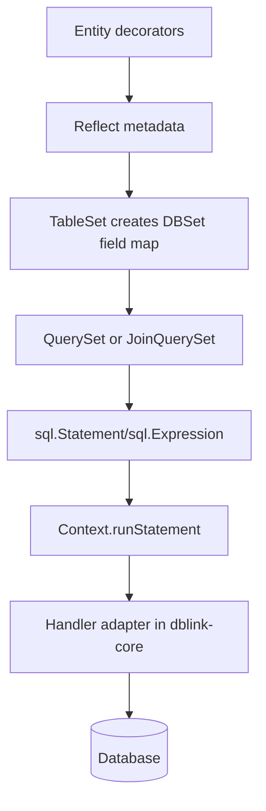
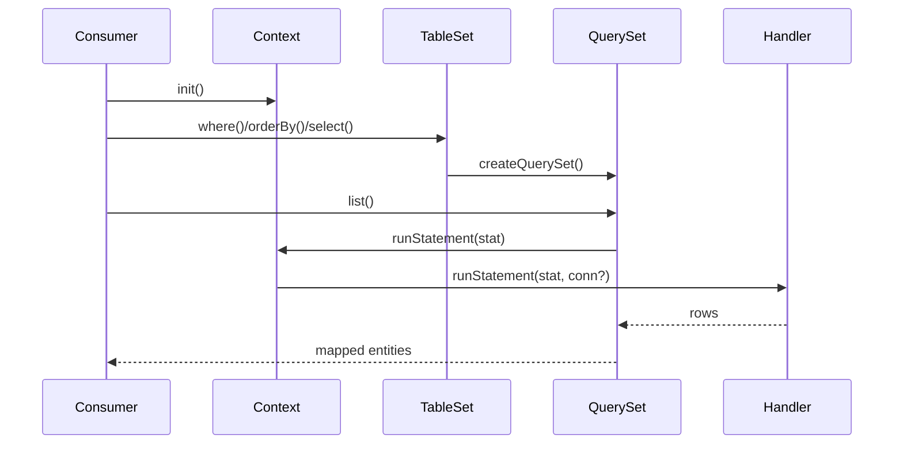

# Architecture

## Purpose

Document the implemented architecture of DBLink as a TypeScript ORM library.

## Architecture

DBLink is centered on three layers:
- Metadata layer: decorators write mapping metadata with `reflect-metadata`
- Query layer: expression builders produce SQL expression trees
- Execution layer: `Context` and `Connection` delegate SQL to a pluggable `Handler`

## Responsibilities

- `Context`: lifecycle, query execution entrypoints, transaction cloning
- `TableSet`: entity-bound CRUD and query start points
- `QuerySet` and `JoinQuerySet`: fluent query composition and result transformation
- Decorators: entity and relationship metadata
- Expression builders: type-safe SQL fragment construction

## Dependencies

- `dblink-core` for SQL AST (`sql.Statement`, `sql.Expression`) and `Handler`
- `class-transformer` for row-to-entity conversion
- `reflect-metadata` for runtime metadata
- `lodash-es/cloneDeep` for transaction context cloning

## Patterns

- Fluent interface for composable queries
- Metadata-driven mapping instead of schema-first generation
- Adapter pattern through `Handler`
- Unit-of-work-like transaction context cloning

## Common mistakes

- Calling `commit()` or `rollback()` without `initTransaction()`
- Missing `@Table` causing `Table Name Not Found`
- Missing mapped fields causing `Field Not Found`
- Using invalid join ON expressions causing `Invalid Join`

## Best practices

- Keep entities fully decorated before binding them in `Context`
- Use `select([...])` for narrower payloads
- Prefer `stream()` for large result sets
- Always rollback transaction contexts on error paths

## Relevant folders

- `src/Context.ts`
- `src/collection/`
- `src/decorators/`
- `src/exprBuilder/`
- `src/model/Connection.ts`

## Mermaid diagrams

## Examples from repository

- Context initialization and table binding in `src/Context.ts`
- CRUD in `src/collection/TableSet.ts`
- Join composition in `src/collection/JoinQuerySet.ts`
- Full workflow coverage in `test/workflow.test.ts`
