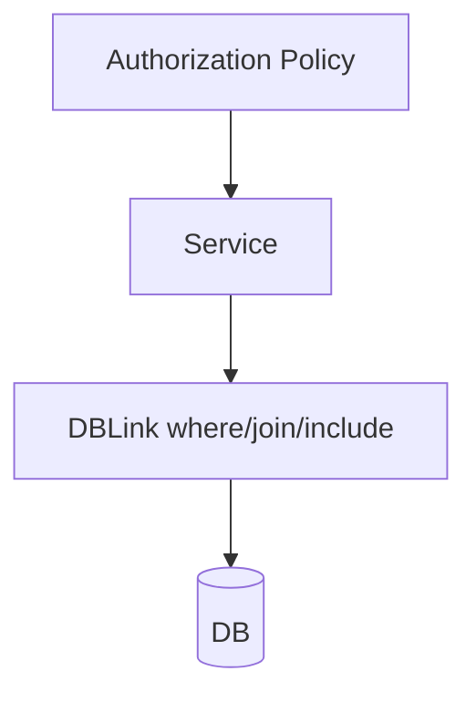

# Authorization

## Purpose

State authorization capabilities and boundaries.

## Architecture

Role/permission enforcement is not implemented in this repository.

Not found in current codebase.

## Responsibilities

- DBLink executes queries; it does not enforce tenant or role access

## Dependencies

Not found in current codebase.

## Patterns

- Consumer layer should inject policy filters into query composition

## Common mistakes

- Treating `where` clauses as a substitute for centralized authorization policy

## Best practices

- Build policy checks in service/controller layer
- Pass only authorized predicates into DBLink queries

## Relevant folders

Not found in current codebase.

## Mermaid diagrams

## Examples from repository

Not found in current codebase.
