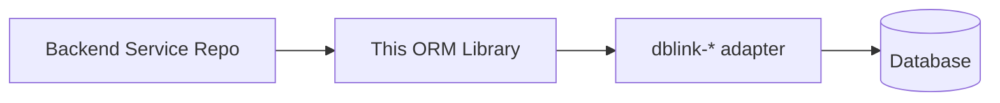

# Backend Context

## Purpose

Clarify backend application architecture assumptions for AI agents.

## Architecture

This repository is a reusable ORM library, not an HTTP backend service.

`Not found in current codebase.` for:
- HTTP server bootstrap
- route registration
- controllers/services wiring
- middleware pipeline

## Responsibilities

- Provide data-access primitives to be embedded into backend services
- Expose query and transaction APIs for application code

## Dependencies

- Database adapter expected from consumer apps (example: `dblink-pg` in tests)

## Patterns

- Library-first API design
- Consumer-owned runtime (server, routing, auth, deployment)

## Common mistakes

- Treating this repo as a complete API server
- Adding app-specific controller logic directly into core ORM modules

## Best practices

- Keep backend-agnostic behavior in `src/`
- Validate backend integration in downstream service repositories

## Relevant folders

- `src/`
- `test/`

## Mermaid diagrams

## Examples from repository

- Library entrypoint exports in `src/index.ts`
- Integration usage shape in `test/Integration.test.ts`
