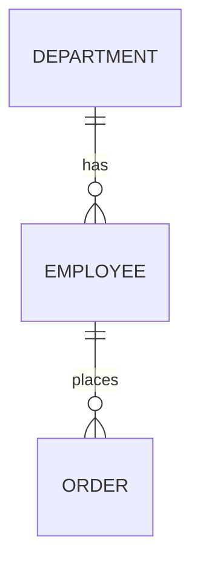

# Business Domain

## Purpose

Describe domain entities present in this repository and their role.

## Architecture

Domain modeling is demonstrative and focused on ORM behavior, not production business processes.

## Responsibilities

- `Employee` belongs to `Department`
- `Order` references `Employee` via `userId`
- Tests validate relationship mapping and includes

## Dependencies

- Decorators from `src/decorators`
- Query APIs from `TableSet` and `QuerySet`

## Patterns

- Example domain objects used as integration fixtures
- Explicit foreign mapping via callback expressions

## Common mistakes

- Assuming these test models represent complete business rules
- Reusing fixture entities as canonical domain contracts

## Best practices

- Treat test models as examples of mapping style
- Define domain invariants in consuming applications or future modules

## Relevant folders

- `test/model/Employee.ts`
- `test/model/Department.ts`
- `test/model/Order.ts`

## Mermaid diagrams

## Examples from repository

- `@Foreign(Department, ...)` in `test/model/Employee.ts`
- `@Foreign(Employee, ...)` in `test/model/Order.ts`
