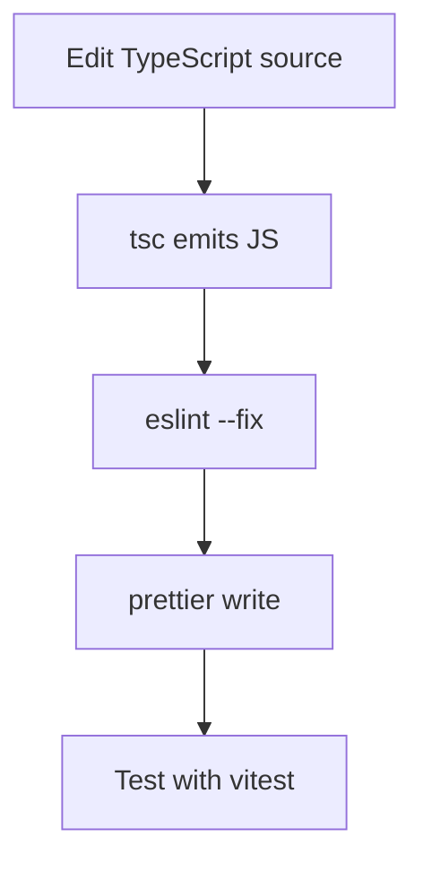

# Coding Standards

## Purpose

Capture coding conventions actually enforced by repository configuration and usage.

## Architecture

Standards are enforced by TypeScript strict mode, ESLint + Prettier, and Vitest.

## Responsibilities

- Maintain dual outputs (`.ts` source and generated `.js` files)
- Preserve ESM imports with `.js` suffix from TypeScript files
- Keep decorators and metadata behavior intact

## Dependencies

- `tsconfig.json` with `strict`, `experimentalDecorators`, `emitDecoratorMetadata`
- `eslint.config.js` with `@eslint/js`, `typescript-eslint`, prettier plugin
- `.prettierrc`

## Patterns

- Strong typing in public APIs
- Generic query builders (`TableSet<T>`, `QuerySet<T>`, `JoinQuerySet<T,U>`)
- Small focused modules under `src/*`

## Common mistakes

- Breaking `.js` import suffixes in TypeScript files
- Editing generated `.js` manually without rebuilding from `.ts`
- Changing decorator metadata keys without coordinated updates

## Best practices

- Modify `.ts` source first
- Run `npm run build` after changes
- Keep method-level JSDoc for public APIs
- Keep fluent API return types precise

## Relevant folders

- `src/**/*.ts`
- `eslint.config.js`
- `.prettierrc`
- `tsconfig.json`

## Mermaid diagrams

## Examples from repository

- Strict generic typing in `src/collection/IQuerySet.ts`
- Decorator usage patterns in `src/decorators/*.ts`
