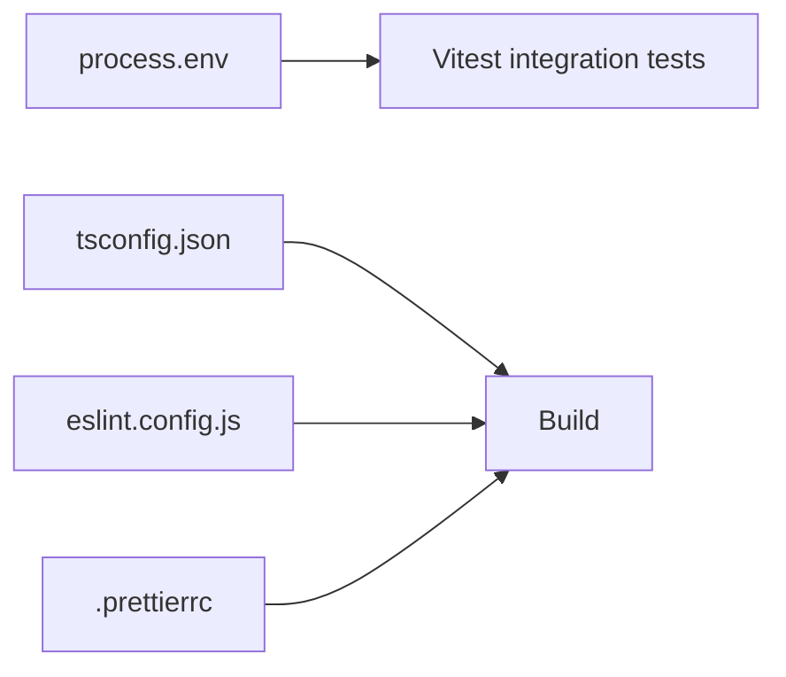

# Configuration

## Purpose

Describe runtime/build configuration sources.

## Architecture

Configuration is file-based plus test-time environment variables.

## Responsibilities

- TypeScript compiler behavior (`tsconfig.json`)
- Lint and format behavior (`eslint.config.js`, `.prettierrc`)
- Test runner behavior (`vitest.config.js`)
- DB connection via env vars in tests

## Dependencies

- Node process environment during test execution

## Patterns

- Defaults to localhost PostgreSQL in integration tests
- Strict TypeScript and ESM module output

## Common mistakes

- Missing decorator metadata compiler flags in downstream consumers
- Using wrong env var names for tests

## Best practices

- Keep config minimal and explicit
- Document required env vars for integration tests

## Relevant folders

- `tsconfig.json`
- `eslint.config.js`
- `vitest.config.js`
- `test/*.test.ts`

## Mermaid diagrams

## Examples from repository

- `DB_HOST`, `DB_PORT`, `DB_NAME`, `DB_USER`, `DB_PASSWORD` in `test/Integration.test.ts`
- `TEST_DB_*` variables in `test/Context.test.ts`
