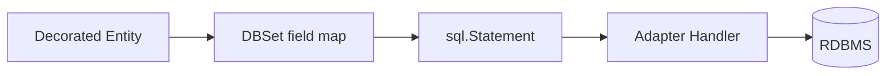

# Database

## Purpose

Describe database interaction model used by DBLink.

## Architecture

- DBLink is adapter-based through `Handler` from `dblink-core`
- SQL is represented via `sql.Statement` and `sql.Expression`
- Tests use PostgreSQL adapter (`dblink-pg`)

## Responsibilities

- Map entity fields to table/column names
- Build and execute CRUD statements
- Support joins, grouping, ordering, limits
- Support transactions through separate connection wrapper

## Dependencies

- `dblink-core`
- Consumer-selected adapter package (`dblink-pg` used in tests)

## Patterns

- Decorator metadata as mapping source of truth
- Primary-key-driven `get/getOrThrow` retrieval
- Bulk operations by statement arrays

## Common mistakes

- Missing primary key metadata for update/delete/get patterns
- Running tests without reachable PostgreSQL at `localhost:5432`

## Best practices

- Ensure all persisted properties have `@Column`
- Use explicit key lists for partial updates
- Use transaction context for multi-step writes

## Relevant folders

- `src/collection/TableSet.ts`
- `src/Context.ts`
- `src/model/Connection.ts`
- `test/*Integration*`

## Mermaid diagrams

## Examples from repository

- Insert/update/delete implementations in `src/collection/TableSet.ts`
- Transaction open/commit/rollback in `src/Context.ts`
- DB config env vars in `test/Integration.test.ts`
