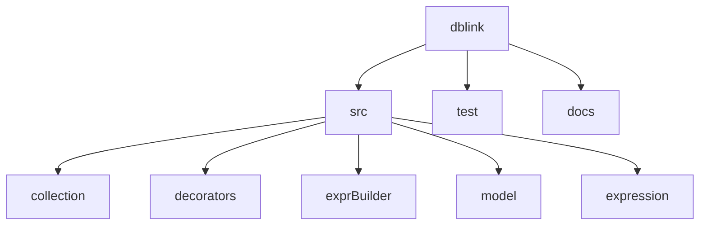

# Folder Structure

## Purpose

Map repository layout and module responsibilities.

## Architecture

Top-level layout:
- `src/`: library source + emitted JS artifacts
- `test/`: Vitest suites and example entities
- `docs/`: supporting docs

## Responsibilities

- `src/collection`: query and table abstractions
- `src/decorators`: metadata decorators and keys
- `src/exprBuilder`: expression helper APIs
- `src/model`: transaction connection wrapper
- `src/expression`: expression helpers (`array`, `cast`)

## Dependencies

- Internal imports mostly cross `src/*`
- External SQL AST from `dblink-core`

## Patterns

- TS and JS side-by-side per module
- Single public package export surface via `src/index.ts`

## Common mistakes

- Treating generated JS files as authoritative source
- Adding new files only in one of TS/JS trees

## Best practices

- Add or modify TypeScript module first, then rebuild
- Keep folder-level concerns cohesive

## Relevant folders

- `src/`
- `test/`
- `docs/`

## Mermaid diagrams

## Examples from repository

- Collection exports in `src/collection/index.ts`
- Root exports in `src/index.ts`
