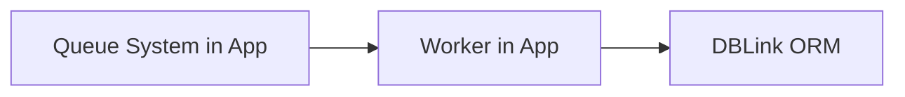

# Queues

## Purpose

Clarify queue and async job infrastructure status.

## Architecture

Queue system implementation is absent.

Not found in current codebase.

## Responsibilities

Not found in current codebase.

## Dependencies

Not found in current codebase.

## Patterns

- Keep queue concerns outside core ORM package

## Common mistakes

- Adding queue-specific runtime assumptions to generic ORM modules

## Best practices

- Implement workers in consuming applications and call DBLink from those workers

## Relevant folders

Not found in current codebase.

## Mermaid diagrams

## Examples from repository

Not found in current codebase.
