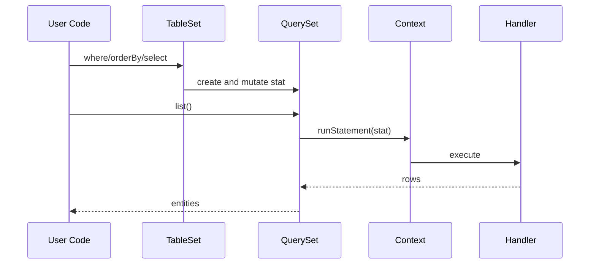

# Request Lifecycle

## Purpose

Describe how a query request flows through DBLink internals.

## Architecture

Lifecycle for fluent queries:
1. Consumer calls `TableSet` methods
2. `QuerySet` or `JoinQuerySet` accumulates SQL AST in `stat`
3. Execution methods call `Context.runStatement()`
4. Handler executes SQL and returns rows
5. QuerySet transforms rows into entity instances

## Responsibilities

- Statement composition without immediate execution
- Type-safe field-to-column mapping
- Optional relationship hydration via `include`

## Dependencies

- `sql.Statement` and `sql.Expression` from `dblink-core`
- `plainToInstance` from `class-transformer`

## Patterns

- Deferred execution
- Fluent AST mutation
- Transform pipeline for list/stream

## Common mistakes

- Expecting DB call at `where()` time
- Misusing `include` without foreign metadata

## Best practices

- Chain query methods before terminal operations (`list`, `count`, `single`, `stream`)
- Prefer `singleOrThrow` when null is invalid

## Relevant folders

- `src/collection/QuerySet.ts`
- `src/collection/JoinQuerySet.ts`
- `src/Context.ts`

## Mermaid diagrams

## Examples from repository

- `prepareSelectStatement()` in `src/collection/QuerySet.ts`
- `list()` and `transformer()` in `src/collection/QuerySet.ts`
