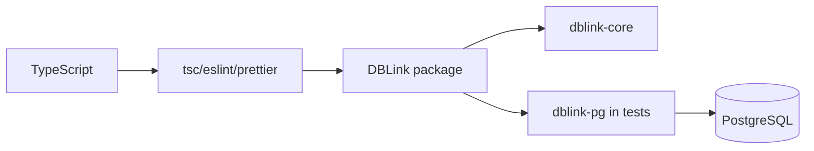

# Technology Stack

## Purpose

Summarize concrete runtime, language, and tooling technologies in use.

## Architecture

- Language: TypeScript (ES2022 target)
- Runtime/module system: Node.js ESM (`"type": "module"`)
- Testing: Vitest
- Lint/format: ESLint + Prettier
- SQL abstraction and handler contract: `dblink-core`

## Responsibilities

- Preserve compatibility with Node 18+ guidance from README
- Provide typed APIs via declaration-friendly TS source

## Dependencies

Runtime dependencies:
- `dblink-core`
- `class-transformer`
- `reflect-metadata`
- `lodash-es`

Dev dependencies:
- `typescript`, `typescript-eslint`, `vitest`, `dblink-pg`

## Patterns

- Adapter architecture for DB-specific packages (`dblink-pg`, etc.)
- Reflect metadata + decorator model mapping

## Common mistakes

- Running tests without a PostgreSQL instance
- Forgetting metadata support in consumer tsconfig

## Best practices

- Keep adapter-specific logic outside this core package
- Use integration tests to validate adapter compatibility

## Relevant folders

- `package.json`
- `tsconfig.json`
- `vitest.config.js`
- `eslint.config.js`

## Mermaid diagrams

## Examples from repository

- Build scripts in `package.json`
- Test environment setup in `vitest.config.js`
