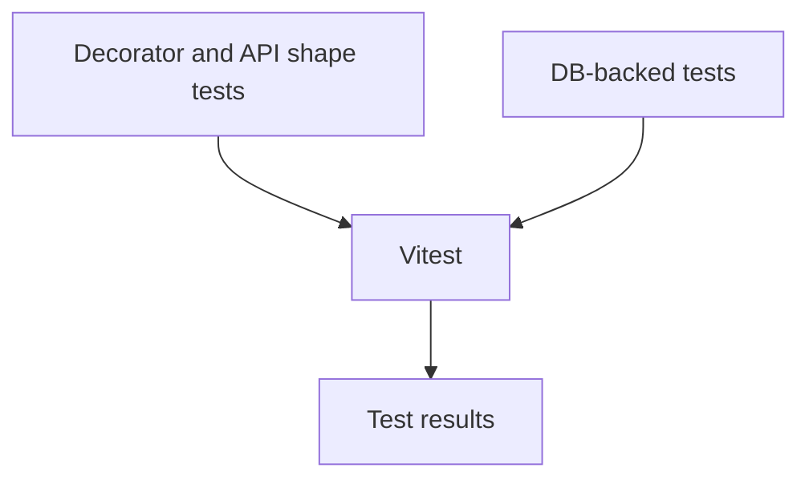

# Testing

## Purpose

Document test strategy, prerequisites, and current behavior.

## Architecture

Test setup uses Vitest in Node environment and includes integration tests requiring PostgreSQL.

## Responsibilities

- Validate decorator metadata behavior
- Validate query builder composition
- Validate context and transaction semantics
- Validate README workflows

## Dependencies

- `vitest`
- `dblink-pg` and accessible PostgreSQL server for integration tests

## Patterns

- Test files in TypeScript with generated JavaScript counterparts
- Environment-driven DB config (`DB_*` and `TEST_DB_*` vars)
- Cleanup helpers drop/recreate tables per test sections

## Common mistakes

- Running full suite without PostgreSQL (`ECONNREFUSED` failures)
- Assuming all tests are pure unit tests

## Best practices

- Start local PostgreSQL before running full suite
- Run targeted test files when iterating
- Maintain deterministic cleanup in integration tests

## Relevant folders

- `vitest.config.js`
- `test/Context.test.ts`
- `test/Integration.test.ts`
- `test/QueryBuilding.test.ts`
- `TEST_SUMMARY.md`

## Mermaid diagrams

## Examples from repository

- Connection env vars in `test/Context.test.ts`
- End-to-end workflow assertions in `test/workflow.test.ts`
- Current run result: failing integration tests without local DB (`npm test`)
