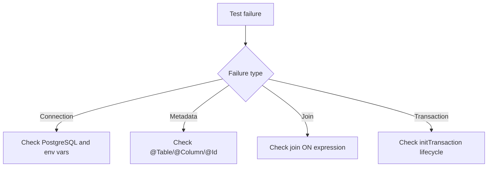

# Troubleshooting

## Purpose

Provide practical debugging guidance for common failures in this repository.

## Architecture

Most issues fall into four buckets:
- Missing metadata/decorator setup
- Invalid query composition
- Transaction misuse
- Missing local PostgreSQL for integration tests

## Responsibilities

- Help AI agents triage quickly
- Map symptoms to concrete files and checks

## Dependencies

- Vitest output
- Decorator metadata in entity definitions
- Handler connection state

## Patterns

- Errors are explicit (`Table Name Not Found`, `Field Not Found`, `Invalid Join`, `Transaction Not Started`)

## Common mistakes

- Forgetting to call `init()` before using table sets
- Running DB tests when PostgreSQL is down
- Passing wrong join keys or missing columns

## Best practices

- Reproduce with smallest failing test
- Inspect generated statement-building path
- Validate metadata keys for affected entity/property
- Use transaction rollback in tests to keep DB clean

## Relevant folders

- `src/Context.ts`
- `src/collection/TableSet.ts`
- `src/collection/QuerySet.ts`
- `test/`

## Mermaid diagrams

## Examples from repository

- Connection refusal failures observed from `npm test` when PostgreSQL is unavailable
- Transaction errors thrown in `src/Context.ts`
